# Process audit: from five islands to a living sea (Oct 5 – Oct 16, 2026)

This file is an honest log of how the project got from the "CV-first" release (commit `547ef97`,
Oct 5) to the world that is live today: what was built, what broke, how each problem was found and
how it was fixed, with the numbers that were actually measured. The earlier phases (Oct 1 – Oct 5)
are summarized in the [README](../README.md#end-to-end-process) and in `Documentation/REVISAO_*.md`.

Everything here can be checked in the repository: the scripts named below, the test scripts in
`Tests/` that produced each number, and the screenshots in `docs/images/process/`.

---

## 0. How the work was done

- **Direction and decisions: me.** I chose every model, every biome, every creature, and approved or
  rejected each result after watching the recorded videos and screenshots. Many Meshy models were
  generated more than once until they looked right.
- **3D models: Meshy.ai.** Islands, biome landmarks, cities, colossi, the Kraken, buoys and props.
  Some came with Meshy's auto-rig; the Kraken maw did not and was rigged in Blender (below).
- **Code: Claude Code as a tool**, connected to Godot and Blender through MCP. During this phase I
  ran several sessions in parallel (world/biomes, creatures and animation, sound, sky, web build),
  each in its own area of the project, coordinated by a main session.
- **Verification rule:** nothing was called done without proof from the engine itself. Every change
  was checked with a headless Godot run (no script errors), and visual changes with scripted
  screenshots or videos recorded with Godot's Movie Maker in the same renderer used on the web.
- **Hard rules kept from the brief:**
  - the original Meshy GLBs are never decimated in place; lighter copies are generated for the web;
  - nothing from Nintendo (models, textures, music, sounds) enters the project or the site;
    references stay on my machine;
  - no publish, commit or deploy without my explicit go-ahead.

---

## 1. Four biomes on an 800 m planet

**Goal:** the sea should never feel empty. From any point you can sail to, something new should be
on the horizon.

- `Scripts/WorldDecor.gd` splits the sphere into four equal sectors with their own art direction:
  - **North:** ruins and living runes;
  - **East:** driftwood and merchants;
  - **South:** abyss, volcano and the ghost sea;
  - **West:** corals and the turtle.
- Placement follows hard rules:
  - 230 m clear around each of the five portfolio islands;
  - a 40 m corridor along the sailing route;
  - 180 m clear around each colossus's path.
- `Tests/biome_layout_dump.gd` lists every item with its distance to the islands and to the route,
  and flags anything that breaks a rule.
- My reference was a 2D chart with 49 positions. Read literally on a sphere it needed a scale of at
  least 1.35, covered only ~39% of the planet and forced four portfolio islands to move. I chose to
  keep the islands and spread the chart's items over the four sectors.
- **Filling holes:** a last pass (`_fill_horizon_holes`) samples the open sea and adds an item
  wherever nothing would be visible.
  - The last full check covered the whole planet: 100% of sampled points with the larger
    landmarks, 99% with the current sizes, and one remaining ~20 m blind cell.

<p align="center">
  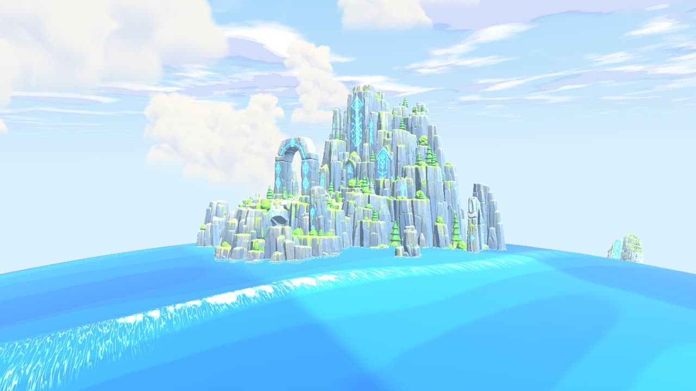
  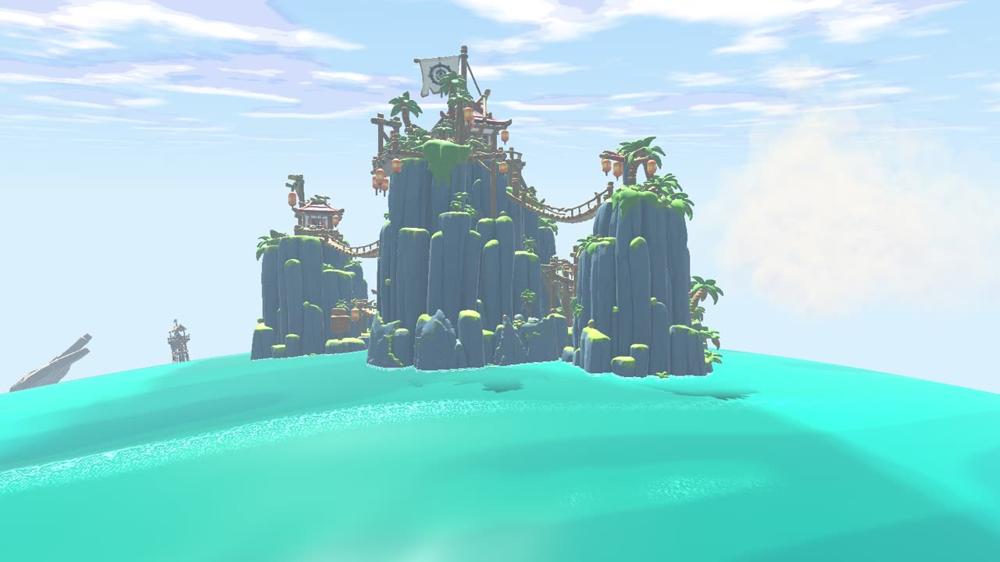
  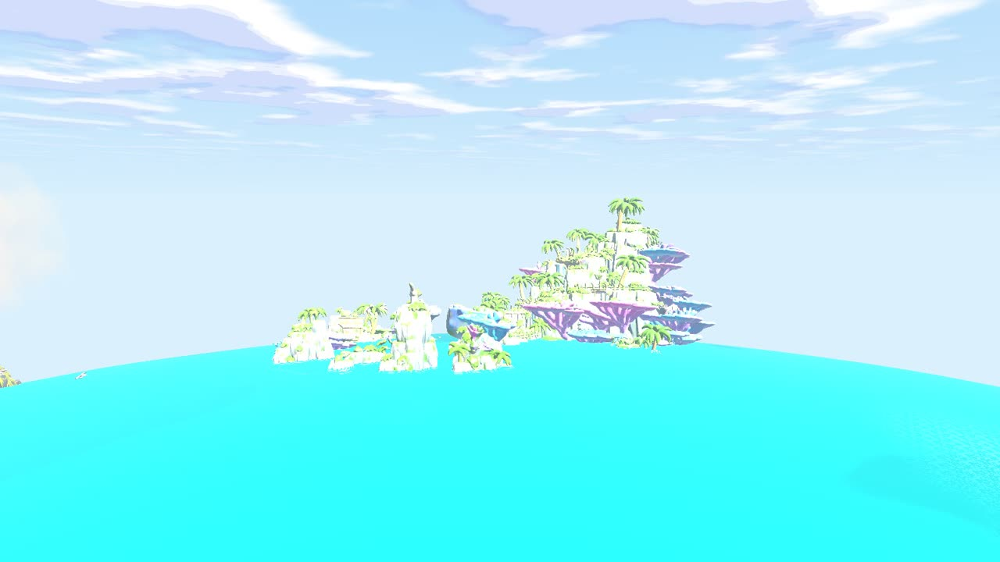
  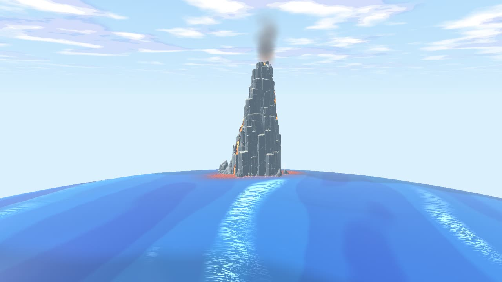
</p>

<p align="center">
  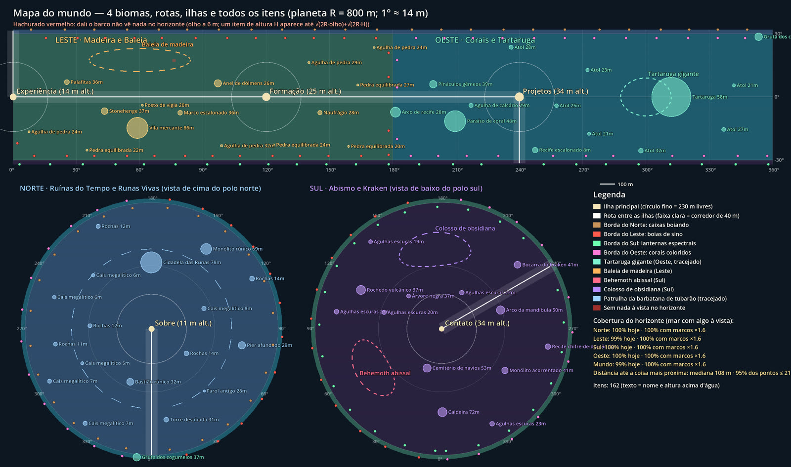
</p>

---

## 2. Colossi, sea life and the Kraken

- **Colossi:** a timber whale, a granite crab, an obsidian giant and a stone turtle carrying an
  island. Each one circles its own sector slowly (`Scripts/SeaBeasts.gd`, the turtle in
  `WorldDecor.gd`). They leave a wake, push ripples on the water and are tied into the calm-water
  system, so the ship floats correctly next to them.
- **Animation:**
  - **Rigged in Meshy:** the colossi used Meshy's rig and were animated in Blender (headless, from
    scripts: `Tools/animate_meshy_rigs_blender.py`, `Tools/rig_creatures_blender.py`).
  - **Body and shell:** stiff "shrimp" motion was rejected more than once. The crab and turtle
    shells are now rigid; only legs, flippers and tails bend.
  - **Kraken maw:** the new model had no rig. `Tools/rig_kraken_maw_blender.py` finds the 9 fangs by
    clustering the vertex angles, builds one bone per fang, weights them by height and angle, and
    adds a looping "Gnash" bite that runs around the ring.
- **Sea life** (`Scripts/SeaLife.gd`, `Scripts/SeaShadows.gd`, `Scripts/Seagulls.gd`):
  - rare dolphin pods that overtake the ship;
  - flying fish and seagull flocks;
  - shadows of animals under the hull.
- **The Kraken** (`Scripts/KrakenEvent.gd`): a rare encounter in open sea.
  - The tentacles rise in groups (1, 3, 2, 1) around a whirlpool and slam the water near the ship,
    pushing it.
  - The rigged maw gnashes in the center.
  - The tentacles sit 14% of their height under the water, so their base never shows.
- **Ghost ship** (`Scripts/GhostShip.gd`): appears only in the southern ghost sea, crosses the bow
  and chases the ship if you get close.

<p align="center">
  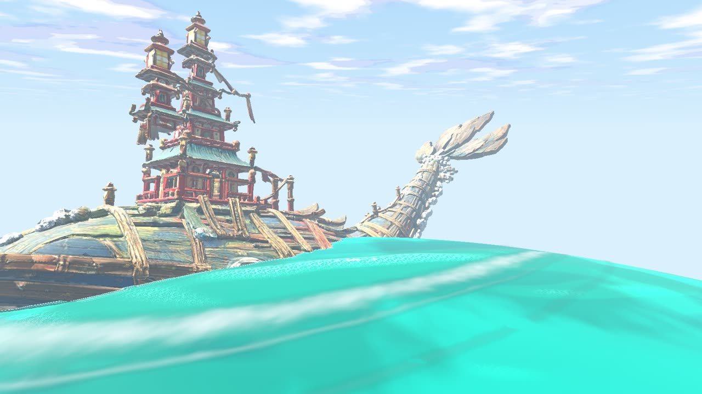
  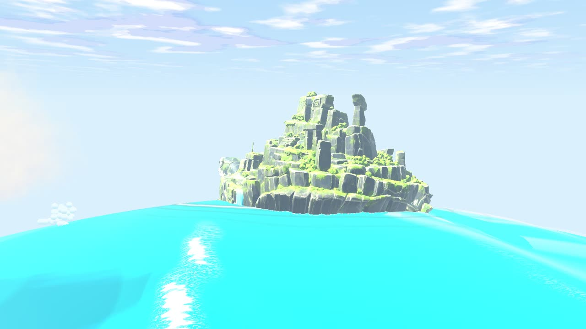
  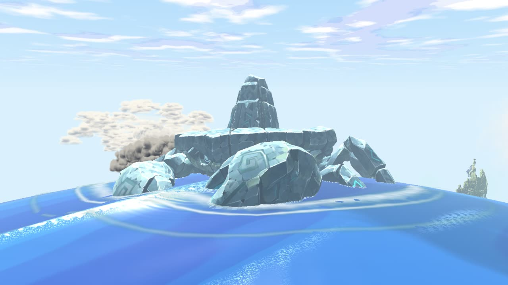
  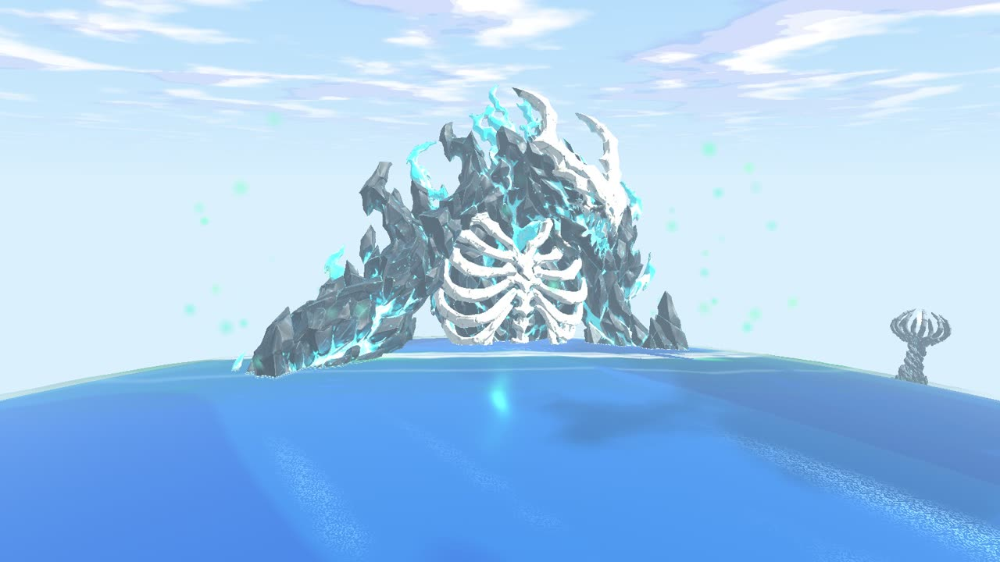
</p>

---

## 3. Weather, sky and sound

- **Weather** (`Scripts/Weather.gd`, `StormCell.gd`, `Cyclone.gd`, `CycloneRide.gd`, `Thunder.gd`):
  - local storms that drift through empty sea, with rain, rough water and lightning;
  - cyclones that pull the ship in, lift it and drop it somewhere else in open sea.
- **Where the ideas came from:** the Wind Waker sea was studied from a reference video captured on
  noclip.website (`Documentation/Plano_Clima_Eventos_Mar.md`). Meshes, shaders, numbers and code
  were made for this project.
- **Sky:** clouds on camera-facing cards baked from Blender volumes (`Scripts/SkyClouds.gd`), a
  stars pass and a sun flare that hides when something solid blocks the sun.
- **Sound:**
  - recordings from Freesound, cut into short loops and one-shots by `Tools/cut_game_sfx.sh`;
  - a few effects synthesized by `Tools/make_sfx.py`.
  - Every CC-BY sound is credited in `Config/sfx_credits.json`. The raw recordings (up to 330 MB
    each) stay out of Git; only the cuts the game uses are versioned.

<p align="center">
  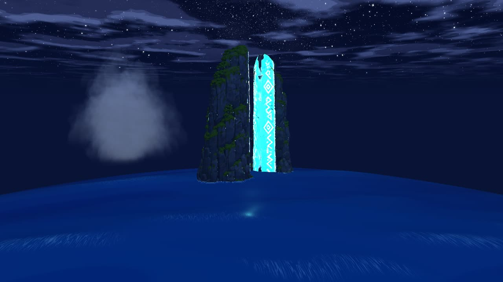
  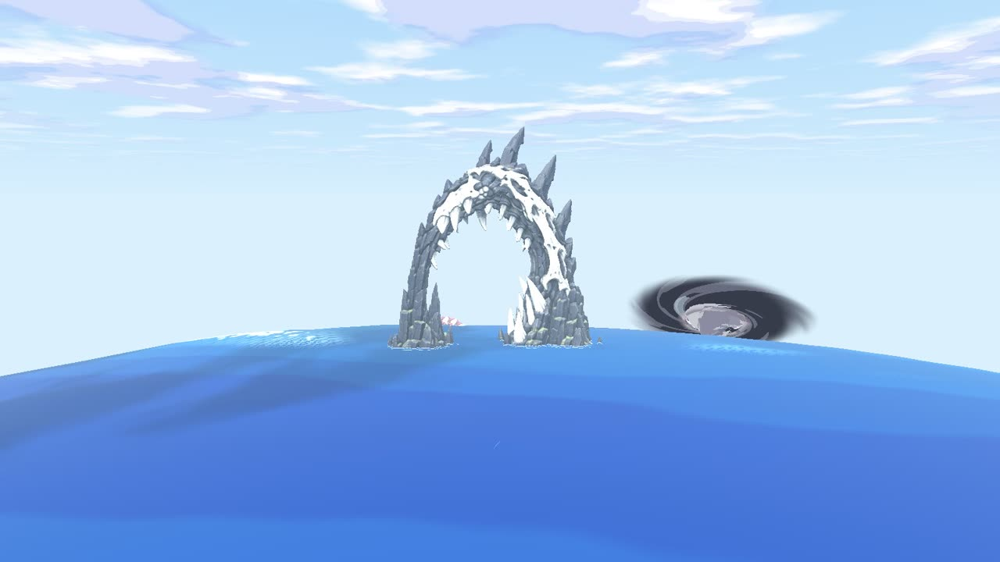
</p>

---

## 4. Problems found and how they were fixed

Each row was found by a test or by me watching a recording, not assumed.

| Problem | How it showed up | Root cause | Fix |
|---|---|---|---|
| Models looked washed out, almost white (whale, turtle) | My note after a colossus video | Exponential fog at 0.0022/m with a light sky color: at ~170 m about 31% of an object's color was fog. Ruled out first: sun flare, glow and material settings | Base fog 0.0022 → 0.0007; storms still thicken it (`FOG_BASE` in `main_world.gd`). Before/after below |
| Stone looked like polished metal | Material dump (`Tests/bright_material_probe.gd`) | Meshy exports `metallic = 1` multiplied by a metallic texture | At load, metallic 0.08 and specular ≤ 0.3 on world models (`_tame_meshy_metal`); the ship keeps its own |
| Cannon aim dots vanished while sailing | `Tests/aim_probe.gd` | The transparent ocean patch was drawn over other transparent effects | `render_priority` on the aim line, the Kraken whirlpool and splashes |
| Kraken splashes rendered as white squares | Frame sheet of the encounter (below) | The particle had no texture | Radial gradient texture |
| Turtle's rear flippers above the water | My note with a screenshot | Meshy weighted the shell rim to the rear flippers, plus a 6° pitch | Rigid rim, 3° pitch, waterline measured in Blender (`TURTLE_WATER_Z`) |
| One world load failed to compile | Headless load | A GDScript type-inference error in `WorldDecor.gd` | Explicit type (`var daylight: float`) |
| Some WAVs did not import | Import log | 24-bit PCM | Converted to 16-bit |
| Two sessions in one Blender | A rig export picked up another session's objects | Both sessions drove the same interactive Blender | Rule: my scripts run in headless Blender only; the rig was redone cleanly |
| The 49-position chart, read literally, covered only 39% of the planet | Layout study | Flat chart coordinates taken literally on a sphere | Decision above (keep islands, spread by sector) |
| Licensing risk | My review | A fan remake of a Nintendo track was on the playlist | Removed from the playlist and from the site |

<p align="center">
  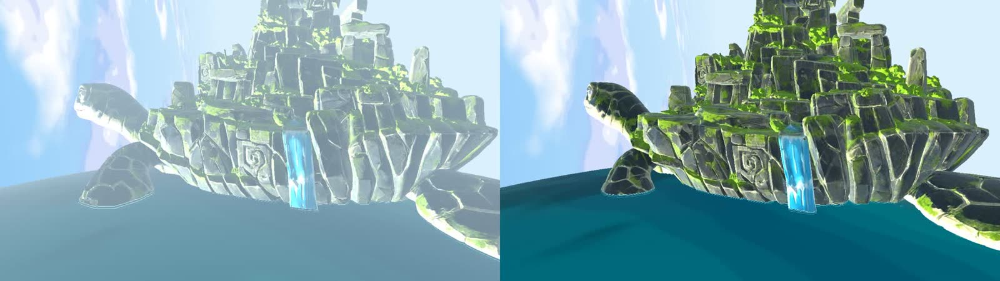
  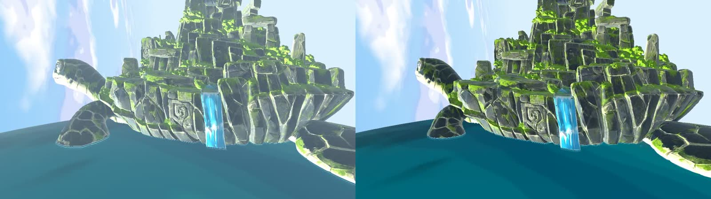
</p>
<p align="center"><sub>Left of each pair: the fog in the game. Right: fog off, for reference. First pair is the old density, second is the new one.</sub></p>

<p align="center">
  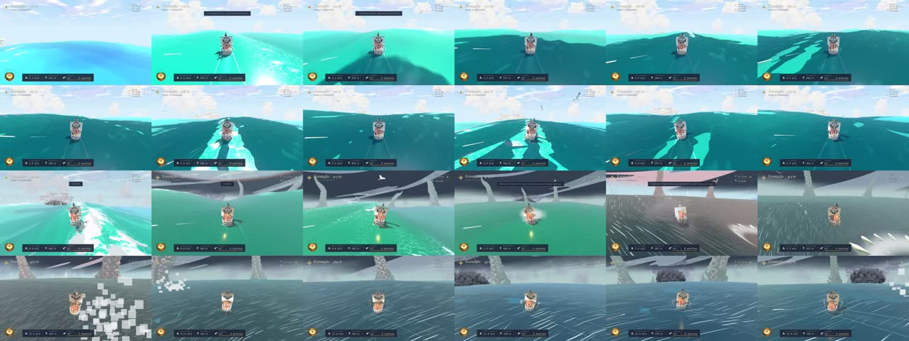
</p>
<p align="center"><sub>Kraken encounter frames recorded during testing. The white squares in the last row are the splash bug from the table above.</sub></p>

---

## 5. Web and mobile: from a 397 MB package to 77 MiB on a phone

The original Meshy models are huge: up to 6.7 million triangles and ~200 MB per file. With them,
the world used **~4.4 GB of video memory** on my PC (`Tests/stress_sail.gd`). That can never run on
a phone, so the site uses generated copies.

**5.1 Web variants.**
- `Tools/make_web_variants.py` runs Blender headless: it welds, decimates and resizes textures into
  `Assets/WebDesktop` and `Assets/WebMobile`. The originals stay untouched as the source.
- Budgets are set per model type (portfolio islands get the most).
- `Tools/compare_web_variants.py` renders original vs desktop vs mobile side by side, so every
  model was checked by eye.

<p align="center">
  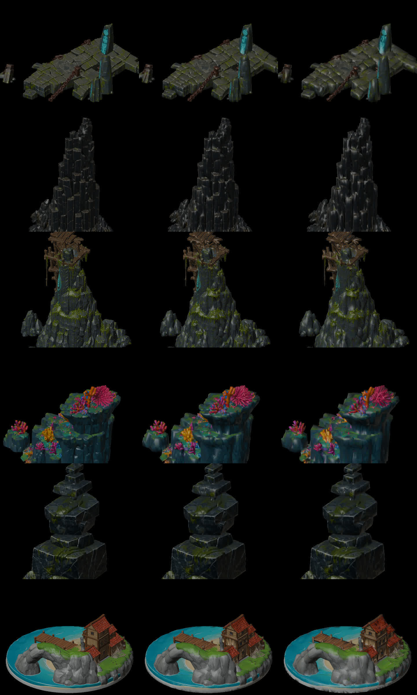
</p>

**5.2 What the first mobile build actually contained.**
- The first export of this phase was **397 MB**. Listing the files inside the package showed what
  had leaked in:
  - raw sound recordings the game never plays (one of 331 MB);
  - 4K textures left over from the original models;
  - three copies of each portfolio island, two of them used only by measuring tools.
- The build now keeps only what the game references.
- Texture sizes depend on how close you see the model:
  - near-view models (islands, sloop, title plates) at 1024 on mobile and 2048 on desktop;
  - everything else at 512 on mobile and 1024 on desktop;
  - sky and clouds unchanged on desktop, 1024 on mobile.
- Music was already streamed by the browser instead of living in the package.

**5.3 Proximity loading.**
- The main package now carries the islands, the sloop, the sea, the creatures and the interface.
- The models of each sector live in their own pack: `world-north.pck`, `world-east.pck`,
  `world-south.pck`, `world-west.pck`.
- How it works:
  1. The build measures every model once: its bounds, its collision outline and whether it has an
     idle animation. It saves this in `Config/world_kinds.json` (`Tests/bake_world_kinds.gd`).
  2. When the world opens, the full map is laid out from those measurements, with collisions,
     lights and effects already in place, even before a single sector model has arrived.
  3. `Scripts/AssetPacks.gd` downloads the packs in the background, the ship's sector first, and
     keeps them in the browser for the next visit. Each model appears as soon as its pack arrives.
- I did not add unloading of far sectors. Measured memory was already low (below), and unloading
  would only add hitches when sailing back.

<p align="center">
  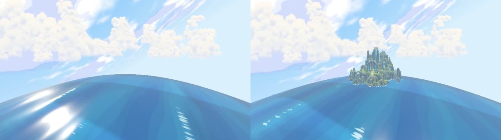
</p>
<p align="center"><sub>Exported package, run outside the editor: right after opening (left) and after the North pack arrived (right).</sub></p>

**5.4 Bugs found only by testing the real build.**
- **The map was different on the web.** The volcano's lava rivers drew from the same random
  generator as the item layout. The search for a river path uses up a different amount of random
  numbers depending on the mesh, and the lighter web volcano has a slightly different surface.
  Every item placed after it moved.
  - Fix: the lava has its own random generator.
  - Check: desktop and web layouts compared item by item are now identical.
- **The packs never mounted in the browser.**
  - The download was set to use a thread, and the web build has none: the request never finished.
  - After that fix, the file `HTTPRequest` should have saved to browser storage was never written.
  - Now the game receives the pack in memory, writes it itself, then mounts it.
  - On the live site, with the browser tab in the background (~1.5 fps), one pack took minutes:
    Godot's `HTTPRequest` reads one chunk per frame. In the browser the download is now a native
    `fetch`, which runs at network speed whatever the frame rate. All four packs then arrived in
    under 30 s even at 1.5 fps.
  - Verified in the browser at phone size: all four packs load, and a second visit loads them from
    cache with no new download.
- **The "Explore in 3D" button still showed old sizes.** It now shows the real package size,
  written by the build.

**5.5 Measured results (this machine, local server):**

| | Before the first frame | Downloaded in the background |
|---|---|---|
| Mobile | **77.1 MiB** (was 397 MB at the start of this phase; 63.5 MiB before the quality pass below) | 4 packs, 7.8–12.4 MiB each |
| Desktop | **222.3 MiB** (139.7 MiB before the quality pass) | 4 packs, 51.5–76.7 MiB each, served in ≤20 MiB parts |

- **Sizes are what crosses the network on a cold load.** Checked with response headers on the live
  site: the package and pack parts are served without `Content-Encoding`, with `Content-Length`
  equal to the file size. Gzip saves only ~2% on them, because the textures are already compressed.
  On top of the package, the browser also downloads the engine (`index.wasm`, 7.1 MB with Brotli),
  `index.js` and the fonts (~1.5 MB).
- **Quality pass (Oct 16).** Testing the live site, I found the web models crude: faceted, low
  detail, and desktop textures halved. The fixes:
  - triangle budgets raised (cities 300k desktop / 70k mobile, landmarks 150k / 35k);
  - rigged colossi no longer decimated on desktop;
  - smooth-by-angle shading after decimation;
  - every model texture at 2048 on desktop.
  - The download grew as a result; that is the trade-off.
**5.6 Time until the boat answers the helm (cold load, measured).** `https://dotpdf.dev/?medir`
- **What the mode does:** it opens the 3D world straight away and throttles the boat up by itself. It
  marks the moment the hull passes 0.5 m/s, then hands the controls back. Times, bytes that really
  crossed the network, FPS, device and network all show on screen.
- **Run 1, Oct 16:**
  - **Device:** desktop PC (RTX 3060 Ti, 16 cores, 32 GB) emulating a phone in the built-in browser
    of the Claude app. Pixel 8 user agent, 375×812 viewport @1.5, mobile package, Medium graphics.
  - **Not a real phone.** The GPU and CPU are far stronger than a phone's.
  - **Network:** home connection. The browser reports "4g · 10 Mbps", but Chrome caps that estimate;
    the package actually arrived at ~170 Mbps (77 MiB in 3.9 s).
  - **Cache:** cold, with Cache Storage and IndexedDB cleared. 125.5 MiB transferred in total, which
    matches package + engine + the four sector packs, so nothing came from the cache.

| Since the click | Time |
|---|---|
| Game package downloaded (77.1 MiB) | 4.2 s |
| Engine ready | 4.4 s |
| Islands built | 9.0 s |
| First smooth frames | 18.0 s |
| **Boat answers the helm** | **18.0 s** |
| Four sector packs downloaded | 20.2 s |
| Every sector model in place | 20.7 s |
| FPS in the 5 s after the helm | 39 |

- **Where the time goes:** on a fast connection, most of the time is first-frame shader compilation
  (9 → 18 s), not the download.
- **On a real 4G line (estimate, not measured):** downloading the ~86 MB needed before the helm alone
  would take ~35 s at 20 Mbps, or ~70 s at 10 Mbps.
- **Run 2, Oct 16, real phone:**
  - **Device:** Samsung Galaxy A55 (SM-A556E), Android 16, Samsung Xclipse 530 GPU (Vulkan, through
    ANGLE), 8 cores, 8 GB.
  - **Viewport:** 384×832 @1.5, mobile package. The page picked Medium graphics because the phone
    counts as "strong" (8 GB, 8 cores).
  - **Network:** Wi-Fi. The browser reports "4g · 9.7 Mbps", a capped estimate; the package actually
    arrived in 5.1 s.
  - **Cache:** cold. 126.7 MB transferred in total, 85.0 MB of it before the helm.

| Since the click | PC emulating a phone | Galaxy A55 |
|---|---|---|
| Game package downloaded | 4.2 s | 5.1 s |
| Engine ready | 4.4 s | 5.9 s |
| Islands built | 9.0 s | 17.0 s |
| First smooth frames | 18.0 s | 25.2 s |
| **Boat answers the helm** | **18.0 s** | **25.2 s** |
| Four sector packs downloaded | 20.2 s | 30.3 s |
| Every sector model in place | 20.7 s | 35.1 s |
| FPS in the 5 s after the helm | 39 | **7** |

- **Run 3, Oct 16, second real phone:**
  - **Device:** a Samsung with an Xclipse GPU, 10 cores, 8 GB. Chrome 155 hides the exact model (its
    reduced user agent reports "Android 10; K").
  - **Viewport and network:** 384×832 @1.5, mobile package, Medium graphics, Wi-Fi ("4g · 1.5 Mbps ·
    rtt 50 ms" is Chrome's capped estimate).
  - **Cache:** cold. 126.6 MB transferred, 84.9 MB of it before the helm.
  - **Times since the click:** package 6.4 s, engine 8.8 s, islands 14.0 s, boat answered the helm
    **18.3 s**, first smooth frames 19.3 s, sector packs 22.0 s, sector models in place 22.5 s.
  - **FPS in the 5 s after the helm: 40.**
  - Same build as run 2; the load range below came after. The first phone ran in a different browser
    (Opera, by its toolbar), and that may explain part of the gap between 7 and 40 fps; this was not
    isolated.
- **The 7 fps is a real problem, and it is reported as measured.** Two caveats:
  - On the phone, the 5 s window right after the helm overlaps the sector packs being downloaded and
    attached (until 35.1 s), so it is a worst case.
  - The game also lowers the graphics tier by itself after a few slow seconds.
- **Fix chosen: a load range, not lighter models.** I chose not to cut model quality.
  - Only the sector models within the load range stay in the scene: 520 m on desktop (the draw
    distance, so nothing changes on screen) and 360 m on mobile, where the planet's curvature already
    hides almost everything.
  - Models outside the range leave the scene and their memory is released. Layout, collisions, lights
    and effects always stay.
  - Exported mobile package run on my PC: 8 of the 160 items hold a model at a time, video memory
    ~160 MB, steady 30 fps on Low.
  - `?medir` now also shows a second FPS window, taken after the nearby models are in place.
  - A new phone run on this build is still pending.

- Every file in the site is under Cloudflare's 25 MiB static-asset limit.
- The mobile package at the Low graphics tier, run on this PC (not on a phone): a steady 30 fps
  with ~240 MB of video memory (`Tests/stress_sail.gd -- low`).

<p align="center">
  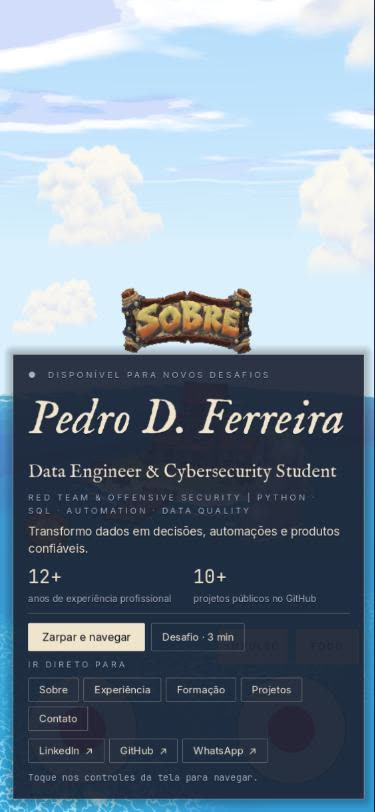
</p>

---

## 5.7 Original textures in the browser, near the boat (Oct 16)

- **The direction:** I want the browser as close as possible to how the model looks in Blender, with
  4K textures, on desktop and on phones. Visual quality is not cut before deploy: any reduction
  happens in the game, and the assets are the last thing to cut.
- **What changed:**
  - The site's base models now carry every map: color, metal/roughness and normal. Dropping maps had
    changed the materials compared with Blender.
  - The original textures (up to 4096 on desktop, 2048 on phones) are prepared by the build, already
    in GPU formats (`Tests/export_hd_textures.gd`).
  - In the game, `Scripts/HDTextures.gd` downloads them when a model comes near the boat and swaps
    them into its materials. When the boat moves away, the model goes back to its base texture and
    the GPU memory is freed.
  - **Limits:** desktop handles up to 10 models at a time within 320 m; phones up to 4 within 180 m.
- **On the server:** 811 MB (desktop, 47 models) and 284 MB (phones, 53 models). A visitor only
  downloads what comes near the boat: on average ~17 MB per model on desktop and ~5 MB on a phone.
- **Exported packages run on my PC:**
  - **Phone package, Low tier:** 21 original textures came in along the route; video memory
    162–214 MB, steady 30 fps.
  - **Desktop package:** 55 textures at 4096; video memory 470–620 MB, 60–75 fps.
- **Fog:** the exponential fog was replaced by depth fog. In clear weather it starts at 320 m, so
  models up to that distance keep their colors; storms still close in. Compared side by side with
  Blender: the remaining difference is the lighting (studio there, daylight here).

<p align="center">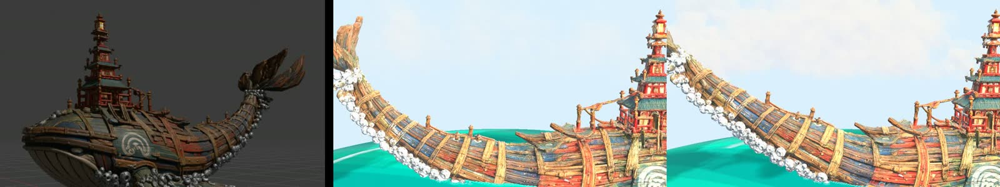</p>
<p align="center"><sub>Blender (left), the site with the base texture (middle) and with the original 4096 texture loaded near the boat (right).</sub></p>

## 5.8 Galaxy A55 again, with the load range and original textures (Oct 16)

- **Conditions:** same phone (SM-A556E, Android 16, Xclipse 530 on Vulkan, 8 cores, 8 GB, 384×832
  @1.5), mobile package. The page picked Medium graphics. The browser reported "4g · 10 Mbps" (a
  capped estimate). Cold cache: 137.2 MB transferred in total, 82.5 MB of it before the helm.
- **Times since the click:**
  - package downloaded 5 s, engine ready 5 s;
  - islands built 18.3 s, first frames 26.5 s;
  - **boat answered the helm 25.5 s**;
  - sector packs 31.6 s, nearby models in place 31.8 s.
- **FPS:** 9 in the 5 s after the helm, **13** once the nearby models were in place.
- **Reading:** the load range shortened the time until the nearby models are in place (35.1 → 31.8 s),
  but FPS stayed low. The page counted the A55 as a "strong phone" and opened on Medium, which its GPU
  cannot hold. The game only lowers the tier by itself after a few slow seconds, and the "settled"
  window came before that.
- **Change:** phones now open on Low. This affects resolution and effects only: internal scale 0.6,
  fewer cloud samples, no sky reflection, 30 fps cap. Models and textures stay the same.
  - `?medir` now also shows the graphics tier in use (and every automatic change), plus a third FPS
    window 20 s after the nearby models are in place.

## 5.9 Galaxy A55 on Low (Oct 16)

- **Conditions:** same A55, Low graphics from the start (the page shows "Baixo @22s", applied when
  the world is built), Wi-Fi ("4g · 10 Mbps" estimate), cold cache (143.9 MB transferred, 89.2 MB of
  it before the helm).
- **Times:** package 8.9 s, engine 9.7 s, islands 22.0 s, **helm 27.8 s**, first frames 30.1 s,
  nearby models in place 35.3 s.
- **FPS:** 9 after the helm, 6 once the models were in place, **15 twenty seconds later**.
- **Reading:** lowering resolution and effects barely moved the A55, so its bottleneck is not the
  graphics tier. Every A55 run so far used Opera, going by its toolbar. The other Samsung, on Chrome,
  held 40 fps on the heavier Medium build.
- **Next measurement:** the same `?medir` run on the A55 in Chrome, to separate the browser from the
  phone before touching anything else.
- **A55 in Chrome (Chrome 155, Low, cold cache, 143.9 MB):**
  - **Times:** package 6.3 s, engine 7.3 s, islands 17.5 s, **helm 24.2 s**, nearby models in place
    28.6 s.
  - **FPS:** 15 after the helm, 22 once settled, 20 twenty seconds later.
  - **Reading:** Opera made it worse (6–15 fps), but the A55 stays near 20 fps in Chrome too.
  - The 40 fps "second Samsung" was a different, stronger phone (10 cores against the A55's 8).
  - Since a 0.6 render scale barely helps, the suspect is the CPU: in the browser the game runs on
    a single thread.
- **Next tool:** `?medir` now turns parts of the game off one at a time, ~30 s after the helm, for 3 s
  each. It reports how many milliseconds per frame each part costs: scripts and drawing of the biome
  decor, the colossi, weather, sea life, gulls, the near sea and its simulation, sky clouds, and the
  boat physics. The next fix targets whatever measures heaviest; models remain the last thing to cut.
- **A55 in Chrome, second run with the per-part tool (Low):**
  - **Times:** package 6.6 s, engine 7.2 s, islands 16.4 s, **helm 23.4 s**, nearby models in place
    31.1 s.
  - **FPS:** 23 after the helm, 28 once settled, **30 twenty seconds later**, which is the Low cap.
  - **Cache:** partly warm, so this is not a cold load: 62.5 MB before the helm, 117.2 MB in total,
    against 143.9 MB cold.
  - **Per-part costs:** the base frame was 33.3 ms, exactly the 30 fps cap. Turning parts off can't
    lower a frame that is already waiting for the cap, so every difference stayed within noise (−0.3
    to +0.3 ms). Weather showed +6.3 ms, also noise. The tool needs the cap lifted while it measures
    (next version).
  - **Reading:** in Chrome the A55 reaches the Low cap of 30 fps after it settles. The low numbers
    came mostly from Opera (6–15 fps) and from the first seconds while models are still arriving.
- **iPhone (iOS 26.6, Chrome on WebKit):** helm at 28.8 s with 103.8 MB transferred. The run is
  incomplete (the FPS lines were still empty) and the battery was at 7%, likely in Low Power Mode.
  Not used in conclusions.

## 5.10 Models that look like the original (Oct 17)

- **What I saw:** in a 15-minute gameplay video in the browser, some models still looked low-poly,
  faceted and crude: "I did not give you these assets like this."
- **Cause:** after decimation, the shading came from the reduced mesh. The smooth-by-angle pass left
  every edge over 40° visible.
- **Fix in `Tools/make_web_variant.py`:** each reduced mesh now takes its normals from the original
  high-poly mesh (Blender Data Transfer, custom normals, nearest face interpolated). Light falls as on
  the Meshy model, and only its own hard edges stay hard.
- **Budgets raised (desktop / mobile):**
  - cities 800k / 150k triangles;
  - landmarks 400k / 80k;
  - portfolio islands 400k / 100k;
  - rigged colossi not decimated on either profile.
  - The load range keeps only nearby models in the scene, so the scene can carry more detail.
- **Result:**
  - Packages: mobile 94.7 MB before the helm, desktop 272.5 MB.
  - Exported mobile package on my PC (Low): 213–252 MB video, 30 fps.
  - Exported desktop package on my PC: 525–711 MB video, 56–60 fps.
- **Also in this round:**
  - **Whale:** swims with its side flippers all the time (4 strokes per 24 s loop); a strong tail
    beat (tip measured from −44° to +40°) comes once per loop.
  - **Sun flare:** lights when any sample of the small sun disk is visible. It used to need the
    average of 13 samples, which went dark when the disk fell between them.

<p align="center">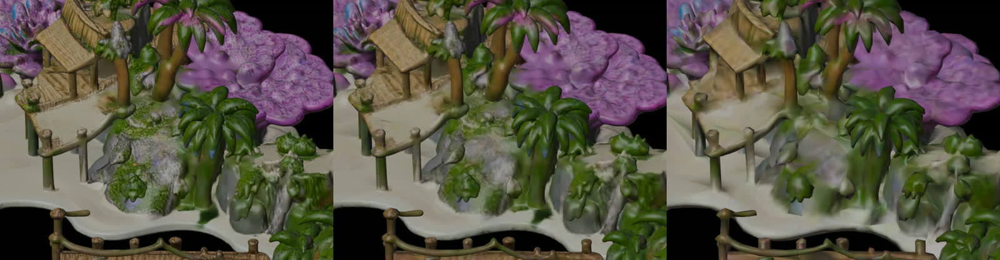</p>
<p align="center"><sub>Coral paradise up close: original Meshy model (4.9M triangles), desktop (800k, normals from the original), mobile (150k).</sub></p>

## 6. What is not in Git, and why

- **Not versioned:**
  - original Meshy exports (`Assets/**/*.glb` outside `Assets/Optimized`);
  - rigged creatures and the ghost ship (16–75 MB per file);
  - raw Freesound recordings;
  - the generated web variants;
  - build output.
- **Versioned:**
  - all code, shaders and tools;
  - every `.import` setting;
  - the optimized islands and sloop;
  - the sound cuts the game plays;
  - the measurements in `Config/world_kinds.json`.
- **What this means for a fresh clone:** the portfolio islands and the sloop work, but biome
  landmarks and creatures need the original files. The web build always regenerates its variants
  from the originals.

## 7. How to reproduce the checks

```powershell
# Layout rules (headless)
Godot.exe --headless --path . --script res://Tests/biome_layout_dump.gd
# Memory and fps while sailing past every island and sector ("-- low" = mobile tier)
Godot.exe --path . --resolution 1280x720 --script res://Tests/stress_sail.gd -- low
# Full site build: variants, sector packs, chunked packages
pwsh Web/build.ps1
# The exported mobile package with its sector packs, outside the editor (run inside Builds/WebMobile)
Godot.exe --main-pack index.pck --script <project>/Tests/packs_probe.gd -- --packs=<project>/Builds/WebMobile/packs --out=<folder>
```
